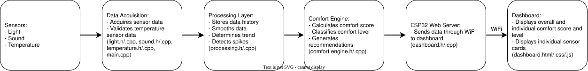
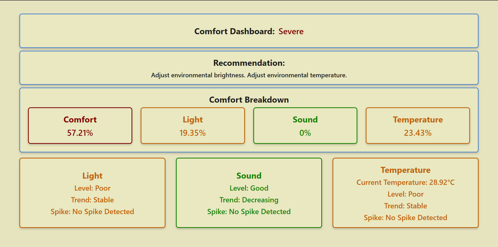
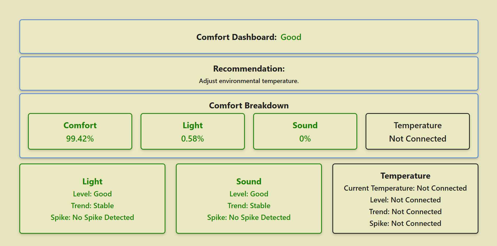
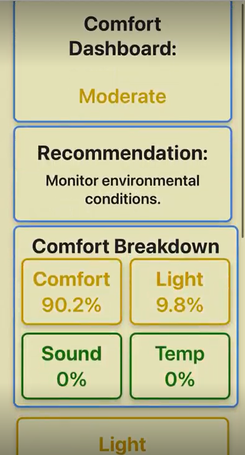
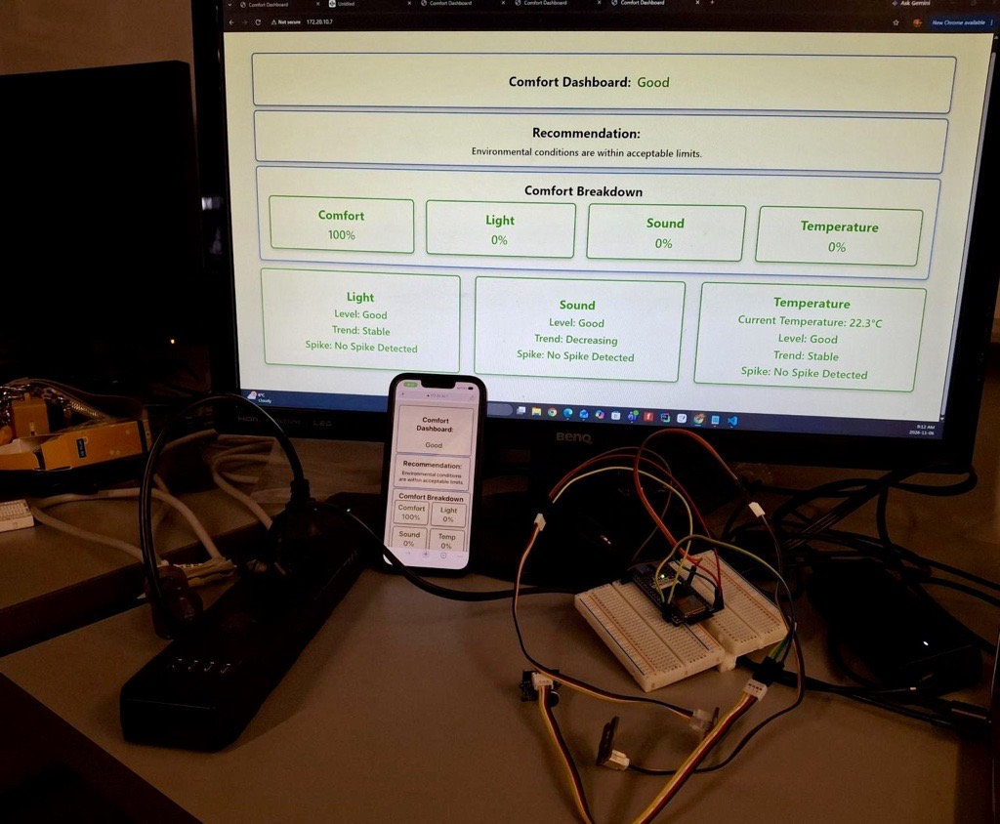
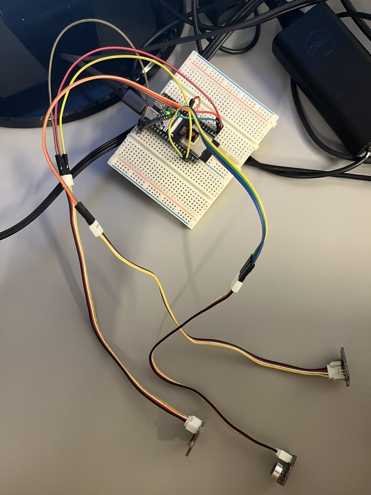

# Health Challenge Sensory Solution: Environmental Monitoring System

## Overview
This project was developed as a sample solution for the Pearl Sullivan Engineering IDEAS Clinic Health Innovation Challenge. 

The Environmental Monitoring System collects data from light, sound, and temperature sensors and performs calculations to process the data. The processed values are displayed on a dashboard shows an overall comfort assessment as both a percentage and a descriptive comfort level as well as individual sensor cards with levels, trends, and spike detections. 

This solution addresses the Sensory subproblem (4.3 Recognizing and Responding to Sensory Discomfort) as it acts as a bridge between an elderly person with sensory sensitivities and their caretaker. The caretaker is able to use the dashboard to get an assessment of the environment and make adjustments to improve the comfort of the elderly person. Additionally, if the elderly person has trouble communicating their discomfort, the monitoring system provides a general gauge of the environment and provides a visual alerts to the caretaker. 

## Components 
### Hardware
- ESP32-S3
- Grove Light Sensor 
- Grove Sound Sensor 
- Grove Temperature Sensor 

### Software 
- Visual Studio Code 
- PlatformIO 
- Arduino Framework 
- LittleFS
- ESP32 WebServer Library 

## System Diagram 

Data is continuously collected from light, sound, and temperature sensors connected to an ESP32. The sensor readings are processed to determine comfort score, level, trend, and spikes before they are sent through the ESP32 web server and displayed on a real-time dashboard accessible over WiFi. 

## Features 
### Sensor Processing 
- Real-time environmental monitoring using light, sound, and temperature sensors 
- Temperature sensor value validation and disconnection visual alert 
- Sensor data smoothing with moving values 
- Trend detection with comparing moving averages (Increasing, Stable, Decreasing)
- Spike detection for sudden environmental changes

### Comfort Assessment 
- Overall and individual comfort score calculation and level classification
- Environment adjustment recommendation 

### Dashboard 
- Real-time ESP32 web dashboard
- Adaptive dashboard layout for desktop and mobile devices 
- WiFi access from any device on the same network

## Design Decisions 
- The temperature sensor is the only one with validation as it is the only sensor which gave readings during testing that were not possible. The light and sound sensor both gave possible readings so if those values were ruled out, actual readings could have been ruled out. When the temperature sensor is disconnected, temperature is excluded from comfort calculations while light and sound monitoring continue to function. Additionally, when the sensor is disconnected, "Not Connected" is displayed on the dashboard and the border and text colour changes to black for a visual alert. 
- The thresholds were determined after research deciding what was considered sensitive for elderly people. For light, over 1000 lux was too bright and an average lighting condition would be around 500 lux. For sound, 70 dB is considered too loud and 30-50 dB is the standard sound conditions. Temperature should stay between 20-24 degrees Celsius. The resources for these thresholds are under references below. 
- The current value for light and sound are not displayed as the Grove sensors read the ADC value (not lux or dB) which would not be useful for a caretaker to read so only the level, trend, and spike detection is displayed. Since the temperature reading is converted to Celsius, the current value is displayed as well. 
- Trend detection compares rolling averages rather than individual sensor readings to reduce the impact of short-term fluctuations. The trend detection also uses a trend decider number which determines between increasing and decreasing and to be a more definitive decider rather than constant fluctuations. The trend detection was included as it would help caretakers see if there was a gradual change in environmental conditions as that can slowly irritate someone. 
- Spike detection compares previous and following values against a threshold to determine if a difference in values is considered a spike. It was included as sudden spikes can irritate an elderly person as it is jarring. 
- The moving-average smoothing was implemented as it would average the readings to get a more accurate and stable number and get more decisive and reliable trends and spikes rather than little sensor irregularities.
- The sound sensor averages 32 ADC readings before processing. Since the sensor measures a fluctuating waveform, averaging multiple samples provides a more stable representation of the environmental noise level. 
- The colours are used as a visual alert and indication of the sensory statuses. 
- The dashboard is hosted directly on the ESP32 using LittleFS and the ESP32 WebServer library. This allows the dashboard to be accessed by any device connected to the same Wi‑Fi network without requiring external servers or cloud infrastructure.
- An adaptive dashboard layout was implemented to allow monitoring from both desktop and mobile devices. 

## Setup
1. Wire sensors to corresponding ESP32 pins and plug in ESP32 to laptop via USB-C cable. 
2. In `dashboard.cpp`, replace `YOUR_WIFI_NAME` and `YOUR_WIFI_PASSWORD` with the SSID and password of the WiFi network the ESP32 will connect to.
3. Ensure device displaying the dashboard is connected to same network as the ESP32. 
4. Under PlatformIO, upload the LittleFS filesystem image. 
5. Upload the project to the ESP32. 
6. Open the Serial Monitor to note what the IP address is. 
7. Paste the IP address into the browser of your device that is displaying the dashboard. 
8. The dashboard should now be running. 

## Screenshots and Images
#### Desktop Dashboard

#### Desktop Dashboard when Temperature Sensor is Not Connected 

#### Mobile Dashboard 

[Mobile Dashboard Screen Recording](media/dashboard_mobile_screen_recording.MP4)

#### Full Solution

#### Sensor Hardware 

## Future Improvements
- Allow customizable thresholds so the system could be more personalized to the sensitivities of each elderly person. 
- Make trend percentage contribution depend on the amount of time the trend is moving in a uncomfortable direction. 
- Make spike percentage contribution depend on if the spike moves in a comfortable or uncomfortable" direction as well as the size of the spike. 
- Physical enclosure for the hardware (eg. 3D printed case, PCB integrating all the sensors). 
- Implement a capping method for the percentages to prevent impossible percentages. 
- Replace Grove sensors with higher accuracy light and sound sensors. 

## References
Microsoft Copilot was used to assist with debugging, documentation feedback, and frontend development questions.
### Sensors
- **Grove Light Sensor:** https://wiki.seeedstudio.com/Grove-Light_Sensor/

- **Grove Light Sensor:** https://www.hackster.io/ingo-lohs/grove-introduction-in-a-light-sensor-a55efd 

- **Grove Sound Sensor:** https://wiki.seeedstudio.com/Grove-Sound_Sensor/

- **Grove Temperature Sensor:** https://wiki.seeedstudio.com/Grove-Temperature_Sensor_V1.2/

- **Grove Temperature Sensor Datasheet:** https://www.berrybase.de/en/product-datasheet/019234a46c1b7364bfdac53da78c407c/create?srsltid=AYCX9vKbi2MFV9sZ_Fe6tFQbCHUPTxSl9p8s2eyOSe_w5k3Rx5OC1KhK 

### ESP32 Web Server Development 
- [Building an ESP32 Web Server: The Complete Guide for Beginners | Random Nerd Tutorials](https://randomnerdtutorials.com/esp32-web-server-beginners-guide/)
- [ESP32 Web Server using LittleFS Filesystem | Random Nerd Tutorials](https://randomnerdtutorials.com/esp32-web-server-littlefs/)
- [ESP32 VS Code PlatformIO: Upload Files to LittleFS Filesystem | Random Nerd Tutorials](https://randomnerdtutorials.com/esp32-vs-code-platformio-littlefs/)
- [ESP32 LittleFS Tutorial: File Storage, Read/Write & Web Server with Arduino IDE](https://www.sunfounder.com/blogs/news/esp32-littlefs-tutorial-file-storage-read-write-web-server-with-arduino-ide?srsltid=AYCX9vK2LbkLpkK1ZWRkeaHvsuKjvVzuStqw1qiqPCh4F5_P0fU3DPNK)
- [DIYables ESP32 Web Server Json Example | ESP32 Tutorial](https://esp32io.com/tutorials/diyables-esp32-web-server-json-example)
- [ESP32 WebServer.h Example — Arduino Web Server in 30 Lines](https://blog.hirnschall.net/esp32-webserver/)

### Dashboard Frontend Development 
- [HTML DOM Element innerHTML Property](https://www.w3schools.com/jsref/prop_html_innerhtml.asp)
- [Learn Changing the Contents of HTML Elements | DOM and HTML Manipulation](https://codefinity.com/courses/v2/b9808bef-5849-468d-b10d-532a2e0a015f/2a6c55b7-8d6e-434b-9304-1705c697dbc5/2828a78c-de46-4659-938b-4798b7c5e2ed) 
- [JavaScript · Bootstrap](https://getbootstrap.com/docs/3.4/javascript/)
- [Window setInterval() Method](https://www.w3schools.com/jsref/met_win_setinterval.asp)
- [15 CSS Card Grid Layouts — Free Live Demos | CodeFronts](https://codefronts.com/layouts/css-card-grid-layout/)
- [Learn CSS Basics by Building a Card Component](https://www.freecodecamp.org/news/learn-css-basics-by-building-a-card-component/) 
- [CSS Stratified Bento Grid Layout — Free CSS Code & Live Demo | CodeFronts](https://codefronts.com/layouts/css-card-grid-layout/css-stratified-bento-grid-layout/)
- https://developer.mozilla.org/en-US/docs/Web/CSS/How_to/Layout_cookbook/Card
- [Responsive Web Design Media Queries](https://www.w3schools.com/css/css_rwd_mediaqueries.asp)